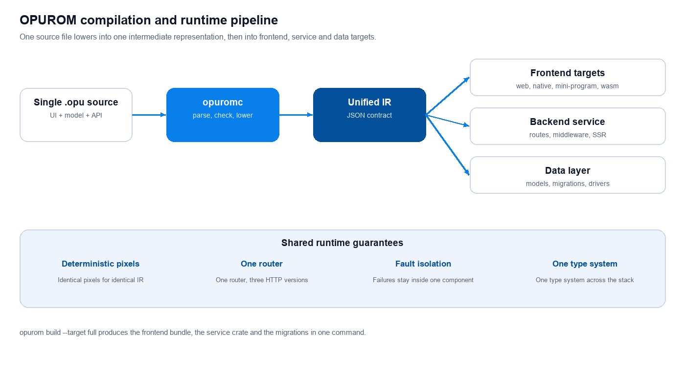

<div align="center">


# Opurom

### One language. One IR. Every screen and every backend.

**A full-stack framework that compiles a single `.opu` source file into frontend bundles,
a native service and database migrations — with deterministic pixels across every target.**

[](https://github.com/opurom/opurom-lang) [](https://github.com/opurom/opurom-render) [](https://github.com/opurom/opurom-cli) [](https://github.com/opurom/opurom-examples)<br>
    

**[Overview](#overview)** &nbsp;·&nbsp; **[Repositories](#repositories)** &nbsp;·&nbsp; **[Quick start](#quick-start)** &nbsp;·&nbsp; **[Roadmap](#roadmap)**

</div>

<br>

## Overview

Opurom is a full-stack framework built around a single intermediate representation. A source
file declares the user interface, the data model and the HTTP API; the compiler lowers that file
once, and the resulting IR feeds the frontend rendering branch, the backend service branch and
the data branch. Production builds run lowered target code — no IR interpreter is shipped.

<div align="center">



</div>

| Property | How Opurom provides it |
| --- | --- |
| **One source of truth** | UI, model and API are declared in one `.opu` file; frontend and backend types originate from the same IR. |
| **Deterministic rendering** | Identical IR and viewport yield identical RGBA bytes on the software, GPU and browser backends. |
| **Lowered targets** | Frontend bundles, a generated Rust service and SQL migrations are emitted as source code, then built by the platform toolchain. |
| **One router, three protocols** | HTTP/1.1, HTTP/2 and HTTP/3 over QUIC dispatch through the same router and the same fault isolation. |
| **Adaptive layout** | Five viewport tiers and an integer-only fluid grid recompute columns, gutters and margins from container width. |
| **Component vocabulary** | 216 named components map onto 100 distinct drawn primitives through a shared catalog. |

The framework is organized as independent repositories, one per layer. Each repository carries
its own contracts, tests and release tags; the IR is the only interface between layers.

## Repositories

The organization publishes one repository per layer.

| Repository | Contents |
| --- | --- |
| [opurom-lang](https://github.com/opurom/opurom-lang) | `opuromc` compiler and target emitters |
| [opurom-core](https://github.com/opurom/opurom-core) | Shared kernel and plugin host |
| [opurom-plugins](https://github.com/opurom/opurom-plugins) | Native-capability plugins and the local registry |
| [opurom-render](https://github.com/opurom/opurom-render) | Deterministic renderer |
| [opurom-gpu](https://github.com/opurom/opurom-gpu) | Metal GPU compute backend |
| [opurom-web](https://github.com/opurom/opurom-web) | Browser DOM and Canvas hybrid |
| [opurom-mobile](https://github.com/opurom/opurom-mobile) | iOS and Android native bindings |
| [opurom-platform](https://github.com/opurom/opurom-platform) | Frontend adapter ABI and headless oracle |
| [opurom-server](https://github.com/opurom/opurom-server) | HTTP service runtime and SSR |
| [opurom-db](https://github.com/opurom/opurom-db) | Data abstraction, SQLite driver, migrations |
| [opurom-runtime-adapters](https://github.com/opurom/opurom-runtime-adapters) | Backend runtime adapters |
| [opurom-cli](https://github.com/opurom/opurom-cli) | `opurom` CLI |
| [opurom-pkg](https://github.com/opurom/opurom-pkg) | Offline package manager |
| [opurom-lsp](https://github.com/opurom/opurom-lsp) | Language server |
| [opurom-debug](https://github.com/opurom/opurom-debug) | DAP debugger |
| [opurom-ide-plugins](https://github.com/opurom/opurom-ide-plugins) | VS Code extension and compiled JetBrains plugin |
| [opurom-examples](https://github.com/opurom/opurom-examples) | Example applications, golden fixtures and the cross-project verification harness |
| [opurom-ui](https://github.com/opurom/opurom-ui) | Default UI theme package |
| [opurom-icons](https://github.com/opurom/opurom-icons) | Icon package for applications |

## Quick start

**Requirements:** Rust toolchain (`rustc`, `cargo`), Node.js 20 or newer, and the Opurom
repositories checked out as sibling directories.

1. **Verify the toolchain.**

   ```sh
   node opurom-cli/bin/opurom.mjs doctor
   ```

2. **Type-check a source file.**

   ```sh
   node opurom-cli/bin/opurom.mjs check opurom-examples/todo.opu
   ```

3. **Build the full-stack Todo application.** The `full` target emits the frontend bundle, the
   generated service crate, SQL migrations and shared types in one directory.

   ```sh
   node opurom-cli/bin/opurom.mjs build \
     --src opurom-examples/todo.opu --target full --out ./build/todo
   ```

4. **Run the generated service and call the API.** The routes come from the `api` blocks in the
   source file; `/health` and `/ssr` are provided by the generated service.

   ```sh
   node opurom-cli/bin/opurom.mjs serve --out ./build/todo --port 8787
   curl -s http://127.0.0.1:8787/health
   curl -s http://127.0.0.1:8787/todos
   ```

A complete walkthrough of every example application is in the
[opurom-examples](https://github.com/opurom/opurom-examples) README.

## Roadmap

The following areas are planned as future directions: additional graphics backends, expanded
window-system adapters, broader device and form-factor conformance, cloud deployment tooling,
an extended component library, and interactive debugging for distributed targets. Each area is
developed as an independent layer integration so the IR contract stays stable.
